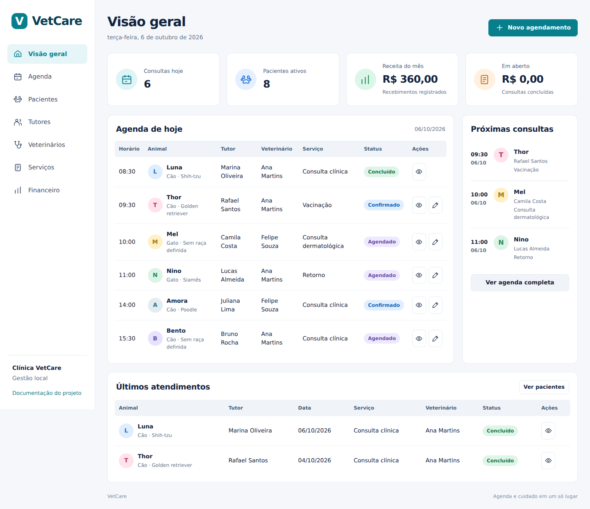

# VetCare

Sistema web local de clínica veterinária para um projeto de Banco de Dados. O foco é mostrar como a modelagem se traduz em tabelas, regras SQL e operações da aplicação.

A interface permite cadastrar tutores, animais, veterinários e serviços, organizar consultas, registrar prontuários e receber pagamentos parciais. O SQLite armazena os dados em um arquivo. Não é necessário instalar um servidor de banco ou compilar o frontend.



## Executar no Windows

Instale Python 3.11 ou superior. Abra o PowerShell na pasta do projeto e execute:

```powershell
py -3 -m venv .venv
.venv\Scripts\python -m pip install -r requirements.txt
.venv\Scripts\python -m flask --app app init-db --demo
.venv\Scripts\python app.py
```

Abra http://127.0.0.1:5000. Os comandos usam o Python do ambiente virtual diretamente e não exigem alterar a política de execução do PowerShell.

## Executar no Linux ou macOS

```bash
python3 -m venv .venv
.venv/bin/python -m pip install -r requirements.txt
.venv/bin/python -m flask --app app init-db --demo
.venv/bin/python app.py
```

Requisito do banco: SQLite 3.37 ou superior. Confira a versão que acompanha seu Python:

```bash
python -c "import sqlite3; print(sqlite3.sqlite_version)"
```

Para começar sem dados fictícios, use `init-db` sem `--demo`. A inicialização não apaga dados. A carga de demonstração só é aceita quando todas as tabelas estão vazias. Para outra demonstração, escolha um novo arquivo pela variável `VETCARE_DATABASE`, sem excluir o banco anterior.

## Material para a matéria

| Arquivo | Conteúdo |
| :--- | :--- |
| [Relatório técnico](docs/relatorio-tecnico.pdf) | Introdução, objetivos, requisitos, modelagem, dicionário de dados, normalização, implementação e scripts |
| [Documentação editável](docs/documentacao.md) | Texto completo do relatório em Markdown |
| [DER](docs/modelagem.svg) | Modelo lógico com chaves e cardinalidades |
| [Modelo conceitual](docs/modelo-conceitual.svg) | Entidades e relações do domínio |
| [01_schema.sql](database/01_schema.sql) | Tabelas, restrições, índices, triggers e view |
| [02_seed.sql](database/02_seed.sql) | Dados fictícios de demonstração |
| [03_queries.sql](database/03_queries.sql) | JOIN, LEFT JOIN, agregações e inspeção do plano de consulta |
| [04_transactions.sql](database/04_transactions.sql) | INSERT, UPDATE, DELETE e transações com ROLLBACK |
| [Roteiro de apresentação](docs/roteiro-apresentacao.md) | Sequência para demonstrar a interface e explicar o banco |

Os nomes, contatos e registros clínicos do seed são fictícios. E-mails usam o domínio `example.com`; CRMVs contêm `DEMO`. As datas da agenda são relativas ao dia da execução em São Paulo.

## Stack e organização

```text
vetcare/
  app.py               Fábrica Flask, proteção CSRF e comandos de banco
  api.py               Rotas JSON e regras das operações
  db.py                Conexões SQLite e inicialização
  validation.py        Validação de campos e valores
  clock.py             Data operacional em America/Sao_Paulo
  database/            Scripts SQL comentados
  templates/           Estrutura HTML
  static/              CSS e módulos JavaScript
  tests/               Testes de integração com banco temporário
  scripts/             Geração da documentação
  docs/                Relatório, diagramas e texto editável
  instance/            Banco local, ignorado no Git
```

Flask serve a página e a API na mesma origem. A interface usa módulos JavaScript nativos. Toda alteração é persistida no SQLite; recarregar a página não apaga os cadastros. O histórico clínico e os recebimentos não podem ser editados ou removidos nesta versão. Cadastros têm arquivamento e reativação.

## Testes

Com o Python do ambiente virtual:

```bash
python -m unittest discover -s tests -v
```

A suíte cria um banco temporário para cada teste. Verifica o fluxo completo, conflitos de horários, precisão monetária, chaves estrangeiras, preservação de preços, arquivamento e imutabilidade do histórico.

## Backup

```bash
python -m flask --app app backup-db backup-vetcare.sqlite3
```

O comando usa a API de backup do SQLite, que inclui dados ainda no journal WAL. Ele recusa um destino existente. Para restaurar, pare o servidor e indique o arquivo de backup na variável `VETCARE_DATABASE` antes de iniciar novamente.

## Gerar novamente o relatório

```bash
python -m pip install -r requirements-docs.txt
python scripts/build_docs.py
```

O gerador lê o esquema real para produzir o dicionário de dados. O texto principal está em `docs/documentacao-base.md`. O PDF inclui a documentação, os diagramas e os scripts SQL completos. O aplicativo não depende do ReportLab para funcionar.

## Uso local e hospedagem

Esta versão foi escolhida para demonstração local. O servidor escuta somente em `127.0.0.1`, sem modo debug. Não há login ou separação de permissões. Use dados fictícios na apresentação.

A Vercel não deve ser usada para gravar este arquivo SQLite como banco persistente em funções. Uma publicação online exige um backend com armazenamento persistente ou uma mudança para um serviço SQLite remoto. Essa migração fica fora da entrega local. O frontend pode ser adaptado depois, mantendo a modelagem como referência.

Configurações opcionais: `VETCARE_DATABASE` altera o arquivo de banco, `VETCARE_SECRET` define a chave de sessão e `PORT` altera a porta. Sem uma chave configurada, a sessão é recriada a cada reinício do servidor. Nunca comite segredos ou bancos com dados pessoais.
