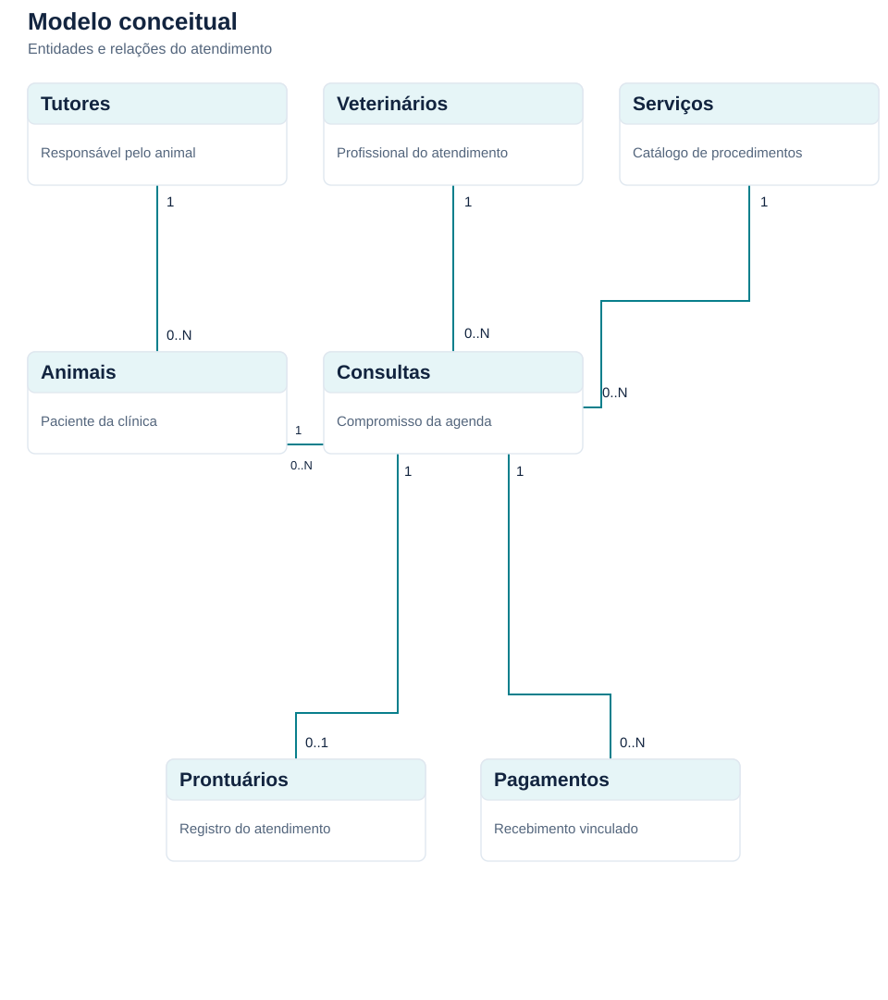
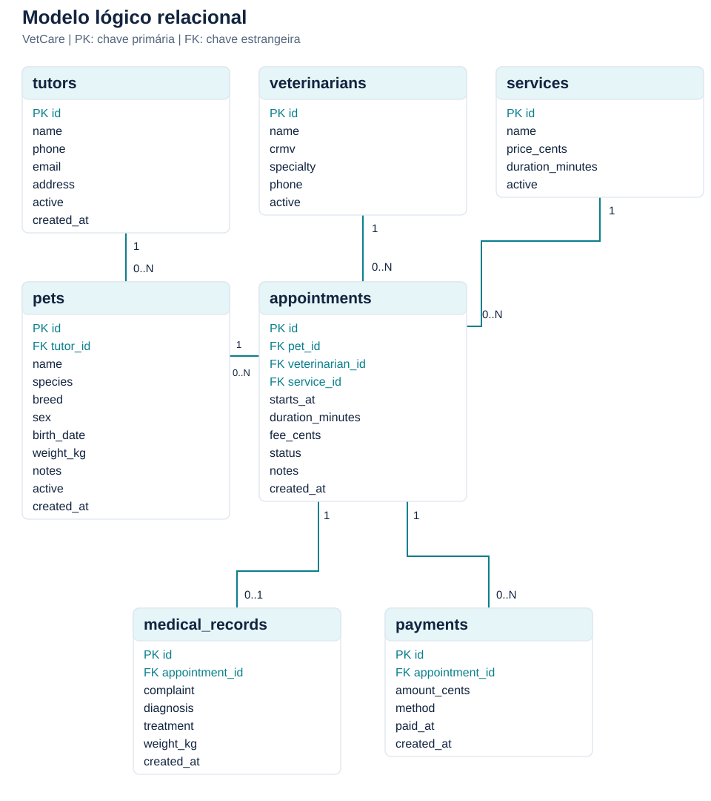

# VetCare: sistema de clínica veterinária

Documentação técnica para projeto de Banco de Dados. Versão 1.0, outubro de 2026.

## 1. Introdução

Uma clínica veterinária precisa relacionar o animal atendido ao seu responsável, ao profissional que realiza a consulta e ao serviço prestado. Agenda, prontuário e recebimento pertencem ao mesmo processo, mas registram fatos diferentes. O horário de uma consulta pode mudar antes do atendimento; o prontuário descreve o que foi observado; o pagamento informa quanto foi recebido e quando.

O VetCare organiza esse processo em uma aplicação web com execução local e demonstração online. O projeto usa SQLite para apresentar a passagem do modelo de dados ao banco físico, com restrições, consultas e transações que podem ser examinadas diretamente. A interface permite executar as operações sem exigir comandos SQL do usuário da clínica.

Os registros iniciais são fictícios e servem à apresentação. O projeto não pretende substituir um sistema clínico em produção. Seu escopo é uma clínica, sem estoque, contas de usuário, faturamento fiscal ou estornos.

## 2. Objetivo geral

Desenvolver e documentar um sistema de clínica veterinária que mantenha os cadastros, a agenda, os prontuários e os recebimentos em um banco relacional SQLite, com uma interface web para operar e demonstrar as regras do modelo.

## 3. Objetivos específicos

- Identificar as entidades do atendimento e definir suas relações e cardinalidades.
- Implementar tabelas com chaves primárias, chaves estrangeiras, limites de domínio e unicidade.
- Separar cadastro, atendimento e pagamento, evitando duplicação de dados descritivos.
- Impedir sobreposição de consultas para o mesmo veterinário ou animal.
- Preservar preço e duração da consulta quando o catálogo de serviços mudar.
- Concluir a consulta e criar seu prontuário em uma única transação.
- Registrar pagamentos parciais e calcular o saldo sem armazenar um total redundante.
- Demonstrar JOIN, LEFT JOIN, agregações, índices e operações de manipulação de dados.
- Documentar a instalação, o código, o script SQL e os testes que verificam as regras.

## 4. Escopo e requisitos

A recepção cadastra os responsáveis e os animais e organiza a agenda. O veterinário registra o atendimento. O financeiro registra recebimentos. Esses papéis descrevem o uso do sistema; a versão local não contém autenticação nem restrições por perfil.

| Código | Requisito funcional | Tela ou operação |
| :--- | :--- | :--- |
| RF01 | Cadastrar, editar, pesquisar, arquivar e reativar tutores | Tutores |
| RF02 | Cadastrar animais vinculados a um tutor e consultar seu histórico | Pacientes |
| RF03 | Manter veterinários com CRMV único | Veterinários |
| RF04 | Manter serviços, preço e duração | Serviços |
| RF05 | Agendar, reagendar, confirmar e cancelar consultas abertas | Agenda |
| RF06 | Bloquear conflitos de horário para veterinário ou animal | Trigger de agenda |
| RF07 | Registrar queixa, avaliação, conduta e peso no prontuário | Atendimento |
| RF08 | Concluir consulta junto com o registro clínico | Transação de atendimento |
| RF09 | Registrar pagamentos parciais sem ultrapassar o saldo | Financeiro |
| RF10 | Exibir agenda do dia, pacientes ativos, receita mensal e pendências | Visão geral |
| RF11 | Preservar o histórico ao arquivar cadastros | Cadastros |

| Código | Requisito não funcional | Implementação |
| :--- | :--- | :--- |
| RNF01 | Instalação sem servidor externo de banco | Arquivo SQLite local |
| RNF02 | Persistência entre reinícios | Banco na pasta instance |
| RNF03 | Interface utilizável em desktop e celular | Layout responsivo e tabelas com rolagem |
| RNF04 | Operações atômicas no atendimento | Transação SQLite com rollback em falhas |
| RNF05 | Entradas validadas e consultas parametrizadas | validation.py e parâmetros SQL |
| RNF06 | Navegação por teclado e identificação dos campos | HTML semântico, rótulos e foco visível |
| RNF07 | Histórico preservado | FK RESTRICT e triggers de imutabilidade |
| RNF08 | Código e banco verificáveis | Testes com banco temporário e scripts independentes |

## 5. Regras de negócio

| Código | Regra | Onde é aplicada |
| :--- | :--- | :--- |
| RN01 | Cada animal pertence a exatamente um tutor | pets.tutor_id NOT NULL e FK |
| RN02 | Uma consulta referencia um animal, um veterinário e um serviço | FKs obrigatórias de appointments |
| RN03 | CRMV e nome de serviço são únicos | UNIQUE |
| RN04 | Consultas não canceladas do mesmo profissional ou animal não se sobrepõem | Triggers de INSERT e UPDATE |
| RN05 | Horários adjacentes são permitidos | Comparação de intervalos semiabertos |
| RN06 | Uma consulta tem no máximo um prontuário | medical_records.appointment_id UNIQUE |
| RN07 | A aplicação conclui o atendimento junto com a criação do prontuário | Transação em finish_appointment |
| RN08 | Um recebimento deve ser positivo e respeitar o saldo | CHECK e trigger payment_limit |
| RN09 | Uma consulta com recebimentos não pode ser cancelada | Trigger appointment_finance_guard |
| RN10 | Preço e duração da consulta conservam o valor contratado | Snapshots em appointments |
| RN11 | Prontuários e pagamentos não podem ser editados ou removidos | Triggers de imutabilidade |
| RN12 | Cadastro arquivado não entra em novo agendamento | Validação da API |
| RN13 | Não se arquiva cadastro com consultas abertas; tutor exige animais arquivados | Validação da API |
| RN14 | Animal com histórico não troca de tutor nesta versão | Validação da API |
| RN15 | Nascimento e pagamento não podem ter data futura | Validação da API |
| RN16 | A aplicação não conclui consultas de uma data futura | Validação da API |

As regras de domínio fixas ficam no banco sempre que o SQLite permite expressá-las de modo direto. Regras de fluxo e de calendário ficam na API. Executar SQL manualmente pode contornar as regras exclusivas da API; os scripts didáticos devem ser executados em um banco de demonstração.

O preço zero é permitido para retornos gratuitos. O campo em aberto do painel soma apenas saldos de consultas concluídas. A tela financeira também mostra consultas agendadas com saldo, pois o sistema permite adiantamentos.

## 6. Modelo conceitual

As entidades do domínio são Tutor, Animal, Veterinário, Serviço, Consulta, Prontuário e Pagamento. Tutor identifica o responsável pelo animal. Consulta representa o compromisso da agenda e liga as entidades do atendimento. Prontuário e Pagamento registram resultados distintos dessa consulta.

| Relação | Cardinalidade | Interpretação |
| :--- | :--- | :--- |
| Tutor possui Animal | Tutor 1 : Animal 0..N | Tutor pode não ter animais; cada animal exige um tutor |
| Animal participa de Consulta | Animal 1 : Consulta 0..N | Cada consulta atende um animal |
| Veterinário realiza Consulta | Veterinário 1 : Consulta 0..N | Cada consulta tem um profissional |
| Serviço compõe Consulta | Serviço 1 : Consulta 0..N | Uma consulta usa um serviço neste escopo |
| Consulta gera Prontuário | Consulta 1 : Prontuário 0..1 | Consulta aberta ou cancelada pode não ter prontuário |
| Consulta recebe Pagamento | Consulta 1 : Pagamento 0..N | Consulta pode não ter recebido ou ter vários pagamentos |

A relação entre consulta e serviço foi limitada a um serviço por consulta para manter o projeto pequeno. Uma consulta com vários procedimentos exigiria uma entidade associativa, como itens da consulta, com quantidade e preço de cada item.

## 7. Modelo lógico

O modelo lógico usa tabelas com identificadores inteiros. Os nomes de tabelas e colunas estão em inglês para manter consistência com o código. Os rótulos da interface estão em português.

- tutors(id PK, name, phone, email, address, active, created_at)
- pets(id PK, tutor_id FK, name, species, breed, sex, birth_date, weight_kg, notes, active, created_at)
- veterinarians(id PK, name, crmv UNIQUE, specialty, phone, active)
- services(id PK, name UNIQUE, price_cents, duration_minutes, active)
- appointments(id PK, pet_id FK, veterinarian_id FK, service_id FK, starts_at, duration_minutes, fee_cents, status, notes, created_at)
- medical_records(id PK, appointment_id FK UNIQUE, complaint, diagnosis, treatment, weight_kg, created_at)
- payments(id PK, appointment_id FK, amount_cents, method, paid_at, created_at)

As FKs usam ON DELETE RESTRICT. A interface arquiva tutores, animais, veterinários e serviços por meio de active=0. Isso preserva vínculos e evita excluir dados usados em consultas anteriores.

## 8. Normalização e decisões de modelagem

Na primeira forma normal, cada coluna guarda um valor do seu domínio. Pagamentos e prontuários são linhas próprias; não há uma lista de consultas ou recebimentos dentro de uma coluna. Endereço é um texto de exibição, sem necessidade de consultas por logradouro neste escopo.

As tabelas usam chaves simples. Assim, não há dependências parciais de uma chave composta, atendendo à segunda forma normal. CRMV é uma chave candidata de veterinarians e name é uma chave candidata de services, ambos com UNIQUE.

Na terceira forma normal, nomes do tutor, do veterinário e do serviço não são copiados para appointments. Eles são obtidos por JOIN. O prontuário referencia a consulta, que já informa animal e profissional. Pagamento referencia a consulta, que informa a cobrança.

fee_cents e duration_minutes de appointments representam condições da consulta no momento do agendamento. Não são cópias que precisam permanecer iguais ao catálogo: mudar o preço de services não muda o preço já acordado. Essa decisão preserva a interpretação histórica dos dados.

weight_kg em pets informa o peso mais recente registrado pela interface. weight_kg em medical_records registra a medição daquele atendimento. A transação de conclusão atualiza ambos quando um peso é informado. Os campos têm significados temporais distintos; o peso histórico não é substituído quando o cadastro muda.

O total recebido e o saldo são calculados pela view appointment_balances. A view agrega pagamentos antes de juntá-los à consulta, produzindo uma linha por consulta. Isso evita somar o preço da consulta várias vezes quando existem pagamentos parciais.

## 9. Modelo físico e dicionário de dados

O script 01_schema.sql cria sete tabelas STRICT, sete índices explícitos, dez triggers e uma view. Também existem índices internos associados a UNIQUE. Tabelas STRICT exigem SQLite 3.37 ou superior [1]. INTEGER armazena IDs, flags e centavos; TEXT armazena textos e datas; REAL armazena peso.

A seção seguinte é gerada a partir do esquema real com PRAGMA table_info e PRAGMA foreign_key_list. As expressões CHECK e os detalhes dos triggers estão no script completo do apêndice.

{{DICTIONARY}}

## 10. Explicação do script SQL

### 10.1. Inicialização e integridade referencial

01_schema.sql ativa foreign_keys antes da transação, cria os objetos com IF NOT EXISTS e grava user_version=1. A execução é não destrutiva. IF NOT EXISTS não é um mecanismo de migração: alterações futuras do esquema precisam de um script de migração próprio.

O SQLite exige que a aplicação ative a verificação de chaves estrangeiras em cada conexão [2]. get_db faz isso ao abrir o banco. A API também configura um tempo de espera de dez segundos para bloqueios de escrita. A inicialização habilita WAL, e o comando de backup usa a API de backup do SQLite.

### 10.2. Tipos, valores e datas

Os valores monetários usam inteiros em centavos. R$ 180,00 é armazenado como 18000. A entrada passa por Decimal antes de ser convertida; valores com mais de duas casas decimais são rejeitados. Isso evita operações de saldo com aproximações binárias de ponto flutuante.

A agenda usa texto no formato YYYY-MM-DDTHH:MM, interpretado como horário civil de America/Sao_Paulo. Nascimento e pagamento usam YYYY-MM-DD. created_at usa UTC com sufixo Z para registrar o instante de criação. Datas de calendário são validadas na API e por CHECK, usando a normalização do SQLite para rejeitar dias inexistentes.

clock.py define o dia operacional pela zona America/Sao_Paulo. Nos scripts de demonstração, date('now','-3 hours') usa a regra UTC-3 vigente para São Paulo. Se a regra de fuso mudar, esses scripts precisarão ser ajustados.

### 10.3. Conflitos de agenda

Os triggers appointment_no_overlap_insert e appointment_no_overlap_update verificam registros existentes para o mesmo veterinário ou animal [3]. O conflito ocorre quando o início de A é anterior ao fim de B e o início de B é anterior ao fim de A. Consultas canceladas não ocupam horário.

Uma consulta das 09:00 às 09:30 permite outra às 09:30. Uma consulta às 09:20, com duração de 30 minutos, é bloqueada. No UPDATE, o registro que está sendo alterado é excluído da comparação pelo seu ID.

### 10.4. Histórico e financeiro

appointment_history_guard bloqueia alterações em consultas que já têm prontuário. record_completed_only exige que a consulta esteja concluída antes de inserir o registro clínico. A aplicação atualiza o status e insere o prontuário na mesma transação, evitando uma conclusão incompleta pelo fluxo da interface.

payment_limit compara o novo valor com a soma já recebida e o preço da consulta. Se a soma ultrapassa o preço ou a consulta está cancelada, o INSERT é abortado. appointment_finance_guard impede cancelamento com recebimentos, troca de animal, profissional ou serviço após receber e redução do preço abaixo do que já foi pago.

Os quatro triggers de imutabilidade impedem UPDATE e DELETE em pagamentos e prontuários. Correções clínicas e estornos exigiriam registros adicionais com justificativa e autoria, que não fazem parte desta versão. Esse limite foi mantido visível nos formulários.

### 10.5. Índices e view

idx_pets_tutor apoia a busca de animais por responsável. Os índices de agenda combinam veterinário ou animal com horário, ajudando a limitar a busca de conflitos. idx_agenda_service apoia o vínculo com o catálogo, e idx_payments_appointment apoia a agregação de recebimentos. idx_agenda_date permite buscas por intervalo de data.

Uma consulta que aplica substr diretamente em starts_at pode não aproveitar o índice por data para a busca. O exemplo Q8 mostra uma busca por intervalo e permite observar seu plano com EXPLAIN QUERY PLAN. Para uma base pequena de apresentação, algumas listagens usam substr por clareza; consultas de produção deveriam ser ajustadas ao volume medido.

appointment_balances é uma view, não uma tabela duplicada. Ela apresenta as colunas da consulta, o valor recebido e o saldo. COALESCE converte a ausência de pagamentos em zero.

### 10.6. Carga, consultas e transações

02_seed.sql carrega seis tutores, oito animais, dois veterinários, quatro serviços, nove consultas, dois prontuários e dois recebimentos. O código de inicialização recusa a carga se alguma tabela já tiver dados. As datas relativas mantêm a agenda útil em apresentações posteriores.

03_queries.sql contém oito exemplos: agenda do dia, quantidade de animais por tutor, receita por forma de pagamento, saldos, histórico clínico, volume de atendimentos, verificações de integridade e plano de consulta. Eles mostram JOIN, LEFT JOIN, GROUP BY, SUM, COUNT e COALESCE.

04_transactions.sql demonstra INSERT, UPDATE e DELETE dentro de transações que terminam em ROLLBACK. O primeiro exemplo cria tutor e animal relacionados; o segundo altera o catálogo sem mudar consultas anteriores; o terceiro remove apenas registros temporários sem dependências restantes.

## 11. Arquitetura e organização do código

O navegador carrega templates/index.html e os arquivos estáticos. As telas usam a API Flask na mesma origem. A API valida os campos, executa SQL parametrizado e devolve JSON. O SQLite confirma ou rejeita a operação conforme as restrições do esquema.

| Arquivo | Responsabilidade |
| :--- | :--- |
| app.py | Cria a aplicação, configura sessão, CSRF, cabeçalhos e comandos de banco |
| api.py | Implementa cadastros, consultas, prontuários, pagamentos e listagem inicial |
| db.py | Abre uma conexão por requisição, fecha conexões e inicializa o banco |
| validation.py | Valida texto, inteiros, opções, peso, dinheiro e datas |
| clock.py | Define a data operacional da clínica |
| static/app.js | Controla navegação, eventos e atualização do estado |
| static/views.js | Monta as telas a partir dos dados da API |
| static/forms.js | Monta formulários com rótulos e limites |
| static/client.js | Faz as requisições e trata erros HTTP |
| static/ui.js | Reúne ícones, tabelas, modais e escape de texto |
| static/style.css | Define cores, tipografia, espaçamento e comportamento responsivo |
| tests/test_system.py | Testa operações e regras em bancos temporários |
| scripts/build_docs.py | Gera diagramas, dicionário e relatório |

O frontend foi dividido por responsabilidade para que a navegação, os formulários e a apresentação não dependam de um único arquivo extenso. Não há etapa de build. O navegador executa módulos JavaScript nativos.

Os nomes de tabela interpolados em SQL pertencem a uma whitelist interna. Valores recebidos do usuário entram como parâmetros. Textos exibidos na interface passam por escapeHTML antes de serem inseridos no HTML.

## 12. API e transações

| Método e rota | Operação | Resultado |
| :--- | :--- | :--- |
| GET /api/bootstrap | Carrega cadastros, consultas, recebimentos e resumo | 200 com JSON |
| POST /api/tutors, pets, veterinarians ou services | Cria cadastro | 201 com ID |
| PATCH /api/{cadastro}/{id} | Edita cadastro ou altera active | 200 |
| POST /api/appointments | Agenda consulta com preço e duração do catálogo | 201 com ID |
| PATCH /api/appointments/{id} | Reagenda ou confirma/cancela consulta aberta | 200 |
| GET /api/pets/{id}/history | Lista consultas e prontuários do animal | 200 com JSON |
| POST /api/appointments/{id}/record | Conclui atendimento e grava prontuário | 201 |
| POST /api/payments | Registra recebimento parcial ou total | 201 com ID |

Validação de conteúdo devolve 400. Ausência de token de sessão devolve 403. Conflitos de integridade devolvem 409. Indisponibilidade do banco devolve 503, com a falha registrada no servidor. A interface apresenta a mensagem junto ao formulário e permite corrigir o campo.

A conclusão do atendimento usa BEGIN IMMEDIATE. O UPDATE exige um status aberto, e o INSERT exige uma consulta concluída. Se uma dessas operações falha, o contexto de transação executa rollback. O peso atual do animal é atualizado na mesma transação quando o prontuário informa uma medição.

Os recebimentos são serializados pelo bloqueio de escrita do SQLite. O trigger verifica o saldo no momento do INSERT, impedindo que dois pagamentos sucessivos ultrapassem a cobrança. O banco foi escolhido para demonstração local com poucos usuários; não foi realizado ensaio de carga para uso simultâneo em produção.

## 13. Interface e uso

A visão geral exibe as consultas do dia, o número de pacientes ativos, os recebimentos do mês e os saldos das consultas concluídas. A agenda oferece data, busca textual e status. Os cadastros mostram registros ativos por padrão, com opção de incluir arquivados.

A consulta abre um resumo com responsável, telefone, serviço, horário, valor e saldo. A partir desse resumo, o usuário pode confirmar, cancelar, atender, receber ou abrir o histórico do animal. A interface informa que prontuários e recebimentos serão preservados após o registro.

Os formulários usam rótulos, campos obrigatórios, limites numéricos e mensagens de erro. Os modais usam dialog nativo, com navegação por teclado e fechamento por Escape. Em telas pequenas, a navegação passa para uma faixa horizontal; tabelas mantêm suas colunas em uma área com rolagem, sem reduzir os textos a tamanhos ilegíveis.

## 14. Instalação e operação

Requisitos: Python 3.11 ou superior, SQLite 3.37 ou superior e navegador com suporte a módulos JavaScript e dialog. Flask é a dependência do servidor; tzdata fornece a base de fusos em sistemas sem esses arquivos, como algumas instalações do Windows. ReportLab só é necessário para gerar o PDF novamente [4].

A sequência de instalação é criar um ambiente virtual, instalar requirements.txt, executar init-db e iniciar app.py. O README contém os comandos para Windows, Linux e macOS. init-db --demo carrega os dados fictícios, enquanto init-db cria apenas o esquema.

O banco padrão fica em instance/vetcare.sqlite3. VETCARE_DATABASE permite escolher outro arquivo. VETCARE_SECRET define uma chave de sessão estável; sem essa variável, a chave é gerada no início e sessões anteriores deixam de valer após reiniciar o servidor. PORT altera a porta, cujo padrão é 5000.

backup-db cria uma cópia consistente pela API SQLite e recusa sobrescrever um destino existente. Copiar apenas o arquivo principal enquanto o servidor escreve pode perder dados ainda no WAL; por isso o projeto fornece um comando de backup [5]. Para restaurar, pare o servidor e configure o arquivo de backup como banco de execução.

Localmente, o servidor escuta em 127.0.0.1 e persiste o arquivo SQLite no computador. Na Vercel, o esquema permanece SQLite, mas cada requisição abre uma imagem em memória, obtida de um Blob privado. Leituras sem cache e gravações condicionais por ETag evitam leituras antigas e sobrescritas concorrentes [7]. O armazenamento usa OIDC e arquivos separados para Production e Preview. O limite da imagem é 4 MiB. Essa configuração atende à demonstração acadêmica, com transferência integral do banco por gravação. Não foi feito teste de carga para uma clínica em produção. Consulte docs/hospedagem-vercel.md para o fluxo e os limites.

## 15. Verificação e limites

A suíte de integração cobre o cadastro ao pagamento parcial, conflito por veterinário, conflito por animal, horários adjacentes, reagendamento, liberação de horário após cancelamento, cobrança acima do saldo, preservação do preço antigo e proteção do histórico. Também verifica CSRF, JSON inválido, unicidade de CRMV, precisão monetária, datas inexistentes e inicialização sem perda dos dados.

Os testes usam bancos temporários separados do arquivo da demonstração. As verificações de integridade usam PRAGMA integrity_check e foreign_key_check. A execução é descrita no README, e o resultado observado está em docs/verificacao.md.

O sistema carrega as listagens completas em /api/bootstrap. Paginação, filtros no servidor e revisão do plano de execução seriam necessários antes de trabalhar com grande volume. A busca atual é textual e não aplica um vocabulário clínico.

Não há login, auditoria por autor, prontuário assinado, envio de lembretes, emissão fiscal, controle de vacinas ou estoque. O cadastro guarda o tutor atual do animal; transferências de responsabilidade exigiriam um histórico próprio. A consulta inclui um serviço. Estornos e correções clínicas também exigiriam novas entidades e regras.

Esses limites definem o que a versão demonstra e o que deve ser modelado antes de ampliar seu uso.

## 16. Referências técnicas

[1] SQLite. STRICT tables. https://www.sqlite.org/stricttables.html. Acesso em 6 out. 2026.

[2] SQLite. Foreign key support. https://www.sqlite.org/foreignkeys.html. Acesso em 6 out. 2026.

[3] SQLite. CREATE TRIGGER. https://www.sqlite.org/lang_createtrigger.html. Acesso em 6 out. 2026.

[4] Pallets Projects. Flask: installation. https://flask.palletsprojects.com/en/stable/installation/. Acesso em 6 out. 2026.

[5] Python Software Foundation. sqlite3: Connection.backup. https://docs.python.org/3/library/sqlite3.html#sqlite3.Connection.backup. Acesso em 6 out. 2026.

[6] Vercel. Is SQLite supported in Vercel? https://vercel.com/kb/guide/is-sqlite-supported-in-vercel. Acesso em 6 out. 2026.

[7] Vercel. Vercel Blob SDK e leituras consistentes. https://vercel.com/docs/vercel-blob/using-blob-sdk e https://vercel.com/changelog/vercel-blob-now-supports-consistent-reads-on-private-storage. Acesso em 6 out. 2026.
